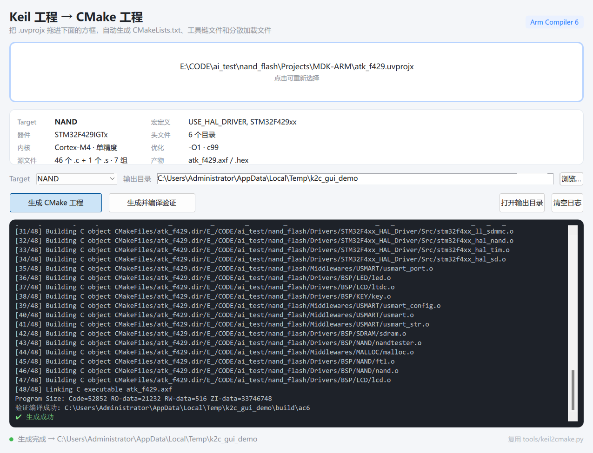

# Keil → CMake 转换工具（PySide6 / Qt Quick）

把 Keil MDK 的 `.uvprojx` 拖进窗口，一键生成 CMake 工程（Arm Compiler 6）。



## 运行

```bat
run.bat
```

或：

```powershell
python main.py
```

依赖：Python 3.9+、PySide6（`pip install pyside6`）。
本机 `D:\miniconda3\python.exe` 自带 PySide6 6.10.3，`run.bat` 会优先用它。

## 用法

1. 把 `.uvprojx` 拖到窗口任意位置（或点击方框选文件）
2. 确认 Target / 输出目录
3. 点 **生成 CMake 工程** 或 **生成并编译验证**

生成的文件：

```
<输出目录>/CMakeLists.txt
<输出目录>/CMakePresets.json
<输出目录>/cmake/toolchain-armclang.cmake
<输出目录>/cmake/<OutputName>.sct
```

然后在输出目录里：

```powershell
cmake --preset ac6
cmake --build --preset ac6
```

## 它做了什么

界面只是壳，真正的转换逻辑在 `../keil2cmake.py`：

- 从 `.uvprojx` 读取源文件分组、宏定义、头文件路径、优化等级、C 语言标准、内存布局
- 从 Keil 注册表定位 `ARMCLANG\bin`（armclang / armasm / armlink / fromelf）
- 依据 `CPUTYPE` + `FPUn` 生成对应的 `-mcpu / -mfpu / -mfloat-abi`、`armasm --cpu/--fpu/--apcs`、`armlink --cpu`
- 启动文件走 `armasm`（传统 `AREA/EXPORT` 语法），C 文件走 `armclang`
- 分散加载文件优先复用 Keil 编译时生成的 `.sct`，没有再按内存布局生成
- 生成后可用 `cmake --build` 验证

## 文件

| 文件 | 作用 |
| --- | --- |
| `main.py` | 入口，加载 QML，注册 backend |
| `backend.py` | Qt↔Python 桥：拖放解析、后台线程生成、日志推送 |
| `Main.qml` | 界面 |
| `run.bat` | Windows 启动脚本 |
